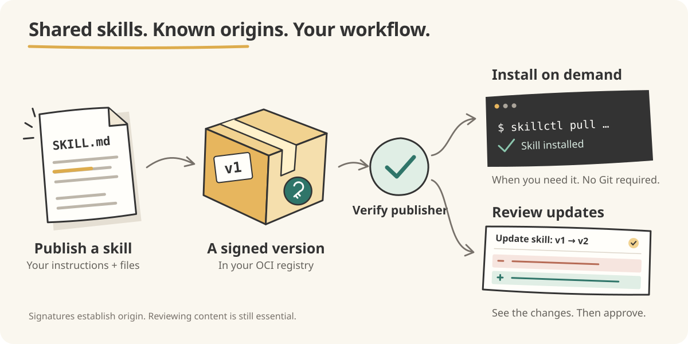

<p align="center">
  
</p>

A software supply chain workflow for AI agent skills.

Agent skills influence what agents do and how they handle your code and data.
Copy-pasting them makes their origin, version, and future updates difficult
to track and audit.

skillctl gives skills a software supply chain workflow: publish versioned
artifacts through OCI registries and verify them against trusted publisher
keys. Install skills interactively when you need them, or manage them as
project dependencies with automated updates and reviewed file changes.



Teams can reuse the registry access controls, signing infrastructure, and
code-review process they already operate. Installed skills are ordinary files
in `.agents/skills/`, following the [Agent Skills](https://agentskills.io)
discovery convention. `skillctl.yaml` records their versions and trust
declarations.

## Trust and signature verification

Signatures verify origin and integrity; they do not establish that a skill's
instructions are safe. Review the content before letting an agent use it.
See the [verification guide](docs/usage.md#trust-and-signature-verification)
for key configuration.

## Installation

Requires Go >= 1.26.

```console
$ go install -tags "exclude_graphdriver_btrfs containers_image_openpgp" \
    github.com/vrothberg/skillctl/cmd/skillctl@latest
```

## Install on demand

Run these commands in any directory. A Git repository is not required:

```console
$ skillctl init
$ skillctl pull --trust none quay.io/vrothberg/skillctl-example-skill:v1.0.0
$ skillctl list
```

The example is unsigned, so `--trust none` explicitly opts out of verification.
For a signed skill, use `--trust key=publisher.pub` to require verification
against the publisher's public key. Later pulls and updates reuse that trust.

## Publish a skill

Publish a directory with your signing key:

```console
$ skillctl publish quay.io/team/my-skill:v1 ./my-skill \
    --sign key=publisher.key --sign passphrase-file=publisher.pass
```

See the [publishing guide](docs/usage.md#publishing-skills) for signing options
and what gets included.

## Reviewed updates across projects

For teams managing shared skills as dependencies, skillctl also fits a Git
review workflow:

1. A maintainer publishes a versioned skill signed with a trusted key.
2. Projects commit `skillctl.yaml`, the public key, and the installed files.
3. Renovate opens pull requests proposing skill version updates.
4. CI verifies and extracts the updated skills, then commits the changed files.
5. Reviewers inspect the actual skill changes before merging.

The [GitHub Action and Renovate guide](docs/usage.md#github-action) provides the
complete setup. See [skillctl-consumer-example](https://github.com/vrothberg/skillctl-consumer-example)
for a live example.

## Further reading

- [Usage guide](docs/usage.md): commands, trust, publishing, manifest format,
  and local changes.
- [Building and testing](docs/usage.md#building-from-source).

skillctl is built on Podman's [libartifact](https://pkg.go.dev/go.podman.io/common/pkg/libartifact).

## License

Apache-2.0
