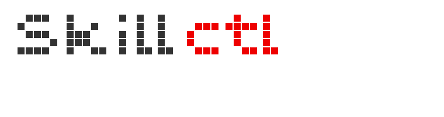

<p align="center">
  
</p>
Distribute shared AI agent skills through OCI registries and update them through reviewed pull requests.

skillctl helps teams reuse skills across projects with explicit signature verification and version tracking.
It installs skills into `.agents/skills/` and records their image references, resolved digests, and trust declarations in `skillctl.yaml`.

It fits teams that already use container registries and want to reuse their publishing and review infrastructure for agent skills.
Renovate can propose version bumps, and CI can verify and extract the updated skills so reviewers see the content changes alongside the manifest changes.

skillctl is built on top of podman's [libartifact](https://pkg.go.dev/go.podman.io/common/pkg/libartifact) package.

## Why OCI?

OCI registries give teams a shared place to publish and distribute versioned skills using the registry access controls and signing infrastructure they already operate.
The same artifact can be consumed by many projects, with each project declaring its own verification key and reviewing updates on its own schedule.

This is particularly useful for organizations distributing internal skills through an existing registry: skillctl connects that publishing infrastructure to the files agents discover in each project.

## Reviewed updates across projects

1. A skill maintainer publishes a versioned OCI artifact and signs it with a key trusted by consuming projects.
2. Each project installs the skill with `skillctl pull --trust key=KEY.pub IMAGE` and commits the manifest, public key, and extracted files.
3. Renovate proposes an image version change in `skillctl.yaml` through a pull request.
4. CI runs `skillctl update`, verifies the artifact against the project's configured key, and commits the extracted files and resolved digest to the PR branch.
5. Reviewers inspect the skill content changes alongside the manifest change before merging.

See [Use with Renovate](#use-with-renovate) for the configuration and [skillctl-consumer-example](https://github.com/vrothberg/skillctl-consumer-example) for an example project.

## Installation

Requires Go >= 1.26.

```console
$ go install -tags "exclude_graphdriver_btrfs containers_image_openpgp" \
    github.com/vrothberg/skillctl/cmd/skillctl@latest
```

Or build from source:

```console
$ git clone https://github.com/vrothberg/skillctl.git
$ cd skillctl
$ make build
$ ./bin/skillctl version
```

## Quick start

```console
$ skillctl init
Initialized skillctl project: skillctl.yaml and .agents/skills/

$ skillctl pull --trust none quay.io/vrothberg/skillctl-example-skill:v1.0.0
Pulling quay.io/vrothberg/skillctl-example-skill:v1.0.0 ...
Pulled skillctl-example-skill (sha256:c696d5bb34aa)
Extracted to .agents/skills/skillctl-example-skill

$ skillctl list
NAME                    IMAGE                                            DIGEST               PATH                                  TRUST
skillctl-example-skill  quay.io/vrothberg/skillctl-example-skill:v1.0.0  sha256:c696d5bb34aa  .agents/skills/skillctl-example-skill  none

$ skillctl remove skillctl-example-skill
Removed skillctl-example-skill
```

Every skill must declare how it is trusted: `--trust key=KEY.pub` pins a public key and requires a valid sigstore signature, `--trust none` explicitly opts out of verification. The declaration is recorded in the manifest and reused for later pulls and updates.

Skills are extracted to `.agents/skills/`, the cross-client discovery convention of the [Agent Skills](https://agentskills.io) ecosystem.
Agents that scan `.agents/skills/`, such as OpenAI Codex and opencode, pick up skillctl-managed skills automatically.

## Commands

| Command | Description |
|---------|-------------|
| `skillctl init` | Create `skillctl.yaml` and `.agents/skills/` in the current directory |
| `skillctl pull --trust ... IMAGE` | Pull a skill from an OCI registry, extract it, and update the manifest |
| `skillctl update` | Pull and extract all skills listed in the manifest |
| `skillctl remove NAME` | Remove a skill from the manifest and delete its extracted files |
| `skillctl list` | List skills tracked in the manifest |
| `skillctl version` | Print the version |

## Extracted files and local changes

Skills are installed into `.agents/skills/<name>/`. When `pull` or `update` extracts a skill, it stages the files before replacing the existing skill directory, removing local edits and files absent from the new version. Installation and removal are confined to the project root; symlinks that escape it are refused.
Make lasting changes in the skill's source and publish a new version; commit the extracted files in consuming projects for review.

Both commands pull the image and compare its resolved digest with the recorded digest. If the digests match, they skip extraction, even if local files have been changed or deleted.
Use `skillctl pull --force IMAGE` or `skillctl update --force` to restore files from the artifact even when the digest is unchanged.

## Manifest format

`skillctl.yaml` tracks skills with their OCI image references, resolved digests, and trust declarations:

```yaml
apiVersion: v1
skills:
    - name: translator
      image: quay.io/redhat/skills/translator:1.0
      digest: sha256:c696d5bb34aa30f6fc23e1f0a0aafd91c642d7d0341e42c2ac009cddc743619f
      extractPath: .agents/skills/translator
      trust:
          key: keys/translator.pub

    - name: skillctl-example-skill
      image: quay.io/vrothberg/skillctl-example-skill:v1.0.0
      digest: sha256:a02ed76caf2de9d1ea33328d9ff0810a87ed37f6721baf9276d4d4023e346447
      extractPath: .agents/skills/skillctl-example-skill
      trust: none
```

The `image` field determines what is pulled. The separate `digest` field records the content retrieved by the last successful pull or update and is used to detect changes; it does not constrain future pulls.
If a tag points to new content, `skillctl update` retrieves that content and updates the recorded digest, even when the image reference in the manifest has not changed.

To pin immutable content, use a digest-qualified image reference instead of a tag. For example, using the digest from the manifest above:

```yaml
image: quay.io/redhat/skills/translator@sha256:c696d5bb34aa30f6fc23e1f0a0aafd91c642d7d0341e42c2ac009cddc743619f
```

References containing both a tag and a digest (`repository:tag@sha256:...`) are also supported. The digest selects the content; the tag is ignored when pulling, but preserved in the manifest for readability and update tooling.

With the custom manager configuration below, Renovate can detect OCI image references and open PRs to bump versions. CI can then run `skillctl update` to pull and extract all skills.

The `trust` entry declares how a skill is verified, and it travels with the version bump: when Renovate updates the image reference and digest, the new version is verified against the same trust as the version it replaces.

See [skillctl-consumer-example](https://github.com/vrothberg/skillctl-consumer-example) for a complete end-to-end example with Renovate integration and CI-driven skill updates.

## GitHub Action

This repository doubles as a GitHub Action, so CI can update skills without installing anything:

```yaml
permissions:
  contents: write

steps:
  - uses: actions/checkout@v7

  - uses: vrothberg/skillctl@main
```

The action runs `skillctl update --force` and commits changed skill files and the manifest.
Configure it via inputs:

| Input | Default | Description |
|-------|---------|-------------|
| `args` | `update --force` | Arguments passed to skillctl |
| `commit-and-push` | `true` | Commit and push updated skill files and the manifest |
| `commit-message` | `Update extracted skill files` | Commit message used when skill files changed |

Until releases are cut, reference the action by `@main`; release tags will serve as action refs as well.

The action installs the CLI with `go install ...@latest` on each run. Pinning the action to a tag or commit pins the workflow implementation, but does not pin the installed CLI version.

### Use with Renovate

Renovate can bump skill versions in `skillctl.yaml` the same way it bumps container image tags, and the action turns those bumps into fully updated PRs.

Point Renovate's regex manager at the manifest, in `renovate.json`:

```json
{
  "$schema": "https://docs.renovatebot.com/renovate-schema.json",
  "extends": ["config:recommended"],
  "customManagers": [
    {
      "customType": "regex",
      "fileMatch": ["skillctl\\.yaml$"],
      "matchStrings": [
        "image:\\s*(?<depName>[^\\s:@]+):(?<currentValue>[^\\s@]+)(@(?<currentDigest>sha256:[a-f0-9]+))?"
      ],
      "datasourceTemplate": "docker"
    }
  ]
}
```

Then run the action only on Renovate's branches, so the updated skill files are committed to the PR:

```yaml
name: update-skills

on:
  push:
    branches:
      - renovate/**
    paths:
      - skillctl.yaml

permissions:
  contents: write

jobs:
  update:
    runs-on: ubuntu-latest
    steps:
      - uses: actions/checkout@v7

      - uses: vrothberg/skillctl@main
```

The resulting flow: Renovate opens a PR bumping the tag in `skillctl.yaml`, the push triggers the action, which pulls the new version and commits the extracted skill files and the resolved digest to the PR branch. Reviewers can inspect both the manifest and the content changes in the same PR.

See [skillctl-consumer-example](https://github.com/vrothberg/skillctl-consumer-example) for a live setup of this flow.

## Trust and signature verification

skillctl is fail-closed about trust: every skill must declare how it is verified, and a skill without a declaration is refused.

| Declaration | Meaning |
|-------------|---------|
| `trust: {key: keys/foo.pub}` | Require a valid sigstore signature by that public key |
| `trust: none` | Explicitly opt out of verification |
| no `trust` entry | `pull` and `update` refuse the skill |

Signature verification establishes that the artifact was signed by the configured key and has not been modified since signing.
It does not evaluate the safety or correctness of the skill's instructions. Review skill content and changes before allowing an agent to use them.

Trust is declared when a skill is added and then lives in the manifest:

```console
$ skillctl pull --trust key=keys/translator.pub quay.io/redhat/skills/translator:1.0
```

Pulling a new version of a tracked skill without `--trust` reuses the declaration recorded in the manifest, and `skillctl update` verifies skills with a pinned key against that key. Skills declaring `trust: none` are pulled without signature verification. Verification happens transparently at pull time via the `containers/image` library, the same mechanism used by `podman pull`.

skillctl derives the signature policy and `registries.d` configuration from the manifest on every run. Each operation uses a private temporary directory, removed when it finishes, so concurrent invocations cannot change each other's verification policy. Ambient system configuration, such as `/etc/containers/policy.json`, is not consulted: trust lives in the repository, so every machine, laptop or CI runner, verifies exactly the same way. See the [containers-policy.json(5)](https://github.com/podman-container-tools/container-libs/blob/main/image/docs/containers-policy.json.5.md) man page for the policy format skillctl generates.

Verification keys are public keys: commit them next to `skillctl.yaml` so CI verifies the same way as local pulls.

Trust is scoped per repository: skills sharing an OCI repository must declare the same trust.

## Store

skillctl keeps its OCI artifact store in `~/.local/share/skillctl/store/`. Override the location with the `--store` flag or the `SKILLCTL_STORE` environment variable:

```console
$ skillctl --store /tmp/skillctl-store pull --trust none quay.io/vrothberg/skillctl-example-skill:v1.0.0
```

### Example: verifying Red Hat skills

Red Hat signs all images on `registry.access.redhat.com` with sigstore, so their skills can be verified the same way you would verify them with `cosign verify`:

```console
$ curl -sLO https://security.access.redhat.com/data/63405576.txt
$ skillctl pull --trust key=63405576.txt registry.access.redhat.com/hi/static:latest
Pulled static (sha256:f7a764cae676)
Extracted to .agents/skills/static
```

## Building

```console
$ make build
```

## Testing

Run unit tests and BATS integration tests locally:

```console
$ make test
```

Run everything inside a container for a reproducible environment:

```console
$ make container-test
```

## License

Apache-2.0
